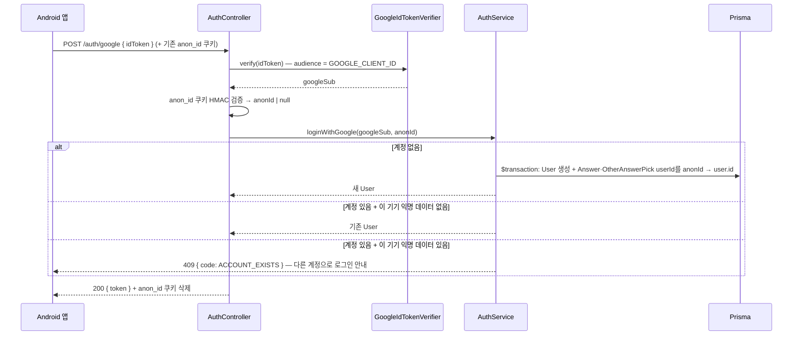
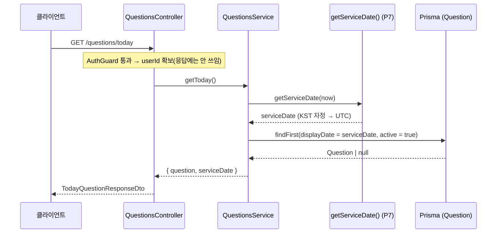
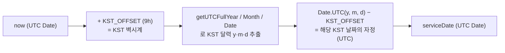
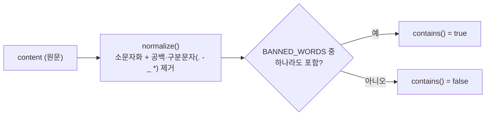

# 하루 하나 (haru-hana) — 백엔드

매일 질문 1개에 답하고 감성 카드를 만드는 **무로그인·익명** 서비스의 백엔드.
개발 규칙은 [`.claude/CLAUDE.md`](.claude/CLAUDE.md), 기획은 `docs/PRD_데일리카드.md`(정책 번호 P1~P7)를 따른다.

- **스택**: NestJS 11 · TypeScript · Prisma + PostgreSQL · Jest
- **배포**: Vercel 서버리스 함수 + Neon(pooled Postgres)

## 실행

```bash
npm install

# 로컬 개발 (src/main.ts, app.listen)
npm run start:dev

# 테스트
npm run test        # 단위
npm run test:e2e    # e2e
npm run test:cov    # 커버리지
```

- 로컬 개발: `src/main.ts` — 포트를 열고 Swagger 문서(`/api`)를 제공한다.
- 서버리스 배포: `api/index.ts` — 포트를 열지 않고 `app.init()`한 Express 인스턴스를 함수 핸들러로 노출한다(Swagger 제외).
- 두 진입점의 미들웨어·파이프(Helmet · CORS · ValidationPipe) 설정은 항상 동일하게 유지한다.

---

## 아키텍처 개요

```
api/index.ts        # 서버리스 진입점 (Vercel)
src/
├─ main.ts          # 로컬 진입점 (Helmet · CORS · ValidationPipe · Swagger)
├─ app.module.ts    # 루트 모듈
├─ config/          # env.validation.ts (Zod, fail-fast)
├─ common/
│  ├─ prisma/       # PrismaService (전역)
│  ├─ auth/         # 세션 토큰 · 전역 AuthGuard · @Public · @UserId (P2)
│  ├─ identity/     # 기존 익명 쿠키 검증 — 첫 로그인 데이터 이전용 (P2)
│  ├─ date/         # serviceDate 유틸 (P7)
│  └─ moderation/   # 금칙어 필터 (P6)
└─ modules/
   ├─ auth/         # Google 로그인 · 익명 데이터 이전 (P2)
   ├─ questions/    # 오늘의 질문 (P3)
   └─ answers/      # 답변 제출·조회, 타인 답변 (P1 · P4 · P5 · P6)
prisma/schema.prisma  # User · Question · Answer · OtherAnswerPick 모델
```

구현 현황: **P0~P1 범위가 모두 구현됨** — questions · answers 모듈과 공통(identity/date/moderation).

---

## 도메인별 흐름도

### 1. 로그인 — P2 (`modules/auth`, `common/auth`)

**Google 로그인 필수.** Android 앱이 Credential Manager로 받은 Google ID 토큰을 `POST /auth/google`로 보내면, 서버가 검증하고 **Bearer 세션 토큰**을 내려준다. User 테이블에는 Google `sub`만 저장한다.



- **마이그레이션은 계정을 처음 만들 때 한 번만** 한다. 기존 계정에 다른 기기의 익명 데이터를 합치면 하루 1회(P1)·배정 고정(P5)이 깨지므로 로그인을 막는다.
- 익명 `anon_id` 쿠키는 더 이상 발급하지 않는다. `AnonIdService`(COOKIE_SECRET HMAC)는 이전할 때 기존 쿠키를 검증하는 데에만 쓴다.
- 세션 토큰 형식: `<userId>.<만료ms>.<base64url HMAC(AUTH_TOKEN_SECRET)>`. 365일 유효하다.
- **전역 `AuthGuard`(APP_GUARD)** 가 `@Public()`이 아닌 전 라우트에서 `Authorization: Bearer`를 검증하고 `request.userId`를 채운다. 컨트롤러는 `@UserId()`로 받는다. 매 요청 응답 헤더 `X-Session-Token`으로 새 토큰을 내려 만료를 "마지막 이용 + 365일"로 민다.
- 가드는 서명 검증 뒤 `User`를 한 번 조회해, 계정이 없거나(탈퇴) 로그아웃(`sessionsRevokedAt`) 전에 발급된 토큰이면 401로 막는다. 이 때문에 요청마다 DB 왕복이 1건 더 든다.
- 로그아웃 `POST /auth/logout`(204): `sessionsRevokedAt`을 지금으로 기록해 이 계정에 지금까지 발급된 토큰을 모두 무효화한다. 발급 시각은 토큰에 없으므로 `만료 시각 − 365일`로 되돌려 구한다 — TTL을 바꾸면 이 계산도 함께 봐야 한다.
- 회원 탈퇴 `DELETE /auth/account`(204): 내 답변·내가 받은 타인 답변 배정·계정(`googleSub` 포함)을 한 트랜잭션으로 **하드 삭제**한다. 계정이 사라지므로 가드가 남은 토큰을 모두 401로 막는다. 내 답변을 배정받았던 다른 사용자의 배정은 FK CASCADE로 함께 지워져, 같은 날 다시 조회하면 재추첨된다(앱은 받은 답변을 그날 기기에 저장해 두므로 이미 받은 사본은 그날까지 남을 수 있다). 같은 Google 계정으로 재가입하면 새 계정이 된다.
- 가드 등록은 `AuthModule`의 provider로 한다. `useGlobalGuards()`를 쓰지 않는다 — 진입점이 `main.ts`·`api/index.ts` 둘이라 한쪽만 고치면 조용히 어긋난다.
- `@Public()`: `POST /auth/google`, `GET /cron/purge-answers`(CRON_SECRET 가드로 인증).

### 2. 오늘의 질문 — P3 (`modules/questions`)

`GET /questions/today`는 **오늘의 질문 + serviceDate** 두 가지만 내려준다. 응답 자체는 사용자와 무관하지만 로그인이 필요하다(전역 AuthGuard).



응답 DTO (`TodayQuestionResponseDto`):

| 필드          | 설명                                                      |
| ------------- | --------------------------------------------------------- |
| `question`    | 오늘 매칭 질문 `{ id, body }`. 운영자 미등록일이면 `null` |
| `serviceDate` | KST 자정 기준 서비스 날짜 (UTC ISO-8601)                  |

- 질문은 순환 로직이 아니라 `displayDate`(serviceDate 매칭 키)로 **DB에서 조회**한다.
- **"오늘 답변했는지"는 여기 없다.** `GET /answers/me`가 그 사실의 단일 진실이다 — 클라이언트는 카드 복원 때문에 어차피 답변 본문이 필요해 그쪽을 써야 하므로, 같은 사실의 출처를 둘로 두지 않는다.
- 부팅 경로의 DB 왕복은 2건이다 — `AuthGuard`의 계정 확인(`User`) 1건과 `Question` 조회 1건. `Answer` 테이블은 조회하지 않는다.

### 3. 서비스 날짜 — P7 (`common/date/service-date.util`)

하루 1회 판정(P1)·질문 전환(P3)의 일관성을 위해, "서비스 날짜"는 사용자 로컬 시간과 무관하게 **KST(UTC+9) 자정**을 기준으로 계산한다. 모든 도메인은 이 단일 함수(`getServiceDate`)만 사용한다.



- 예) KST 2026-06-19 00:00 → 반환 `UTC 2026-06-18 15:00`. DB에는 UTC로 저장되며 `Question.displayDate` 매칭 키로 쓰인다.
- Vercel 함수는 UTC로 실행되므로 로컬 타임존 게터(`getHours`/`getFullYear` 등)를 쓰지 않고 `getUTC*`·`Date.UTC`만 사용한다(진입점·런타임 무관 불변식).

### 4. 금칙어 필터 — P6 (`common/moderation/profanity.service`)

답변 제출 시 서버에서 콘텐츠를 검사해 어뷰징·유해물을 차단하기 위한 공용 서비스. **"검사"만 책임진다** — 차단 시 어떤 HTTP 응답을 줄지는 호출하는 도메인 서비스(answers, Phase 3)가 결정한다.



- 정규화로 `ㅅ ㅂ`, `f.u.c.k` 류의 단순 우회를 완화한다. 금칙어 목록은 최소 기본값이며 운영 중 보강한다.
- `POST /answers` 제출 흐름에서 호출되며, 걸리면 `AnswersService`가 400으로 변환한다.

---

### 5. 내 기록 — 월별 조회 (`modules/answers`)

`GET /answers/me/history?month=YYYY-MM`은 그 달(KST 달력, P7)의 본인 답변을 날짜 오름차순으로 내려준다. 앱의 "내 기록" 화면이 달 단위로 불러가 기기에 저장해 두고, 이미 받은 달은 다시 부르지 않는다.

```json
{
  "answers": [
    {
      "serviceDate": "2026-10-21",
      "question": "오늘 하루 중…",
      "content": "…",
      "bgType": "color",
      "bgValue": "#FFE8D6"
    }
  ]
}
```

- 지난 질문은 앱이 알 방법이 없으므로 질문 본문을 함께 담는다. `serviceDate`는 KST 날짜 라벨(`formatServiceDate`)이다.
- 달 범위는 `getServiceMonthRange`(serviceDate `start` 이상 `end` 미만)로 계산한다. 날짜 계산을 유틸 밖에 두지 않는다.
- 그 달에 답변이 없으면 `{ "answers": [] }`. `month` 형식이 틀리면 400.

## 데이터 모델 (`prisma/schema.prisma`)

| 모델              | 용도                      | 핵심 필드                                                                                                                             |
| ----------------- | ------------------------- | ------------------------------------------------------------------------------------------------------------------------------------- |
| `User`            | Google 로그인 사용자 (P2) | `id`(uuid) · `googleSub`(@unique). 개인정보는 저장하지 않는다                                                                         |
| `Question`        | 오늘의 질문 (P3)          | `body` · `displayDate`(@unique, serviceDate 매칭 키) · `active`                                                                       |
| `Answer`          | 답변 (P1 · P4)            | `userId` · `questionId` · `content` · `bgType`/`bgValue` · `serviceDate`<br/>`@@unique([userId, serviceDate])`로 하루 1회를 DB가 강제 |
| `OtherAnswerPick` | 타인 답변 배정 (P5)       | `userId` · `questionId` · `answerId`<br/>`@@unique([userId, questionId])`로 고정 노출을 DB가 강제                                     |

> `userId`는 `User.id`를 **외래키가 아닌 문자열로** 참조한다. 아직 계정으로 옮겨지지 않은 익명 시절 데이터가 anonId 값으로 남아 있을 수 있기 때문이다(보유 기간이 지나면 cron이 지운다).

- 런타임 연결은 `DATABASE_URL`(pooled/PgBouncer), 마이그레이션은 `DIRECT_URL`(non-pooled)을 쓴다.
- Rust 엔진 없는 클라이언트(`engineType = "client"`)를 쓰므로 `binaryTargets`는 두지 않는다. 커넥션 풀은 driver adapter(`@prisma/adapter-pg`)의 `pg.Pool`이 관리한다.

## 환경변수

`config/env.validation.ts`가 Zod로 검증하며 누락/오류 시 **즉시 종료(fail-fast)**한다.

| 변수                | 용도                                                                                            |
| ------------------- | ----------------------------------------------------------------------------------------------- |
| `DATABASE_URL`      | 런타임 DB 연결(pooled)                                                                          |
| `DIRECT_URL`        | 마이그레이션용 직접 연결                                                                        |
| `COOKIE_SECRET`     | 기존 anon_id 쿠키 HMAC 검증 키 (P2). **기존 값 유지** — 바꾸면 미이전 기기의 쿠키가 무효가 된다 |
| `AUTH_TOKEN_SECRET` | 세션 토큰 HMAC 서명 키 (P2)                                                                     |
| `GOOGLE_CLIENT_ID`  | Google OAuth 웹 클라이언트 ID — ID 토큰 audience (P2)                                           |
| `CORS_ORIGINS`      | CORS 허용 오리진 화이트리스트                                                                   |
| `NODE_ENV`          | 실행 환경                                                                                       |
| `PORT`              | 로컬 개발 포트                                                                                  |
